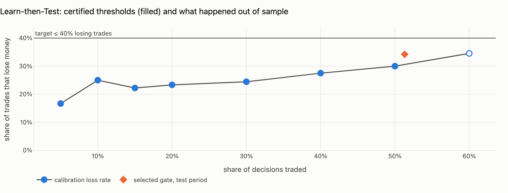

# queuesight

[](https://github.com/VaraSamuel/queuesight/actions/workflows/ci.yml)

Mid-price forecasting on a limit order book, evaluated the way a desk would:
after crossing the spread, with latency, and with a statistical guarantee on
how often the trades it takes lose money.

Most LOB forecasting work (DeepLOB, TransLOB, the FI-2010 benchmark) reports
classification accuracy. I wanted to know whether that accuracy is tradable,
and whether you can put a bound on the risk of acting on it. So this repo does
three things:

1. **Simulates a book with a hidden informed trader.** Queue-reactive arrivals
   (cancellations scale with resting depth), plus a latent Markov regime that
   tilts aggressive flow, passive placement and cancels. Models never see the
   regime, so any edge has to come from inferring it out of order flow. Because
   the simulator does know it, I can check whether they did.
2. **Forecasts direction over the next *h* events** with three models behind
   one interface: logistic regression on multi-level OFI, gradient-boosted
   trees on 24 microstructure features, and a small conv + GRU on raw
   snapshots (DeepLOB-style, optional).
3. **Decides when to trade using distribution-free methods:**
   - **Learn then Test** (Angelopoulos et al. 2021). It picks a conviction
     threshold such that, with probability at least 1 − δ, the share of trades
     that lose money after costs is at most a target you choose.
   - **Conformal prediction sets.** Trade only if the set is exactly `{up}` or
     `{down}`. There's a split version, a class-conditional (Mondrian) version,
     and **adaptive conformal inference with delayed labels**, because a
     horizon-*h* outcome is only known *h* events later and the online update
     has to respect that.

The backtest buys at the ask and sells at the bid, fills *L* events after the
signal, and never holds overlapping positions.


## Results

Means ± sd over 8 independently simulated markets (600k events each,
h = 200 events, 1 event latency, no fees, gradient boosting). Reproduce with
`python -m queuesight.robustness`. Raw per-seed numbers are in
[`results/`](results/). The charts are from a single run (seed 7, the
`python -m queuesight.report` default), which happens to be the LTT gate's
worst seed. I left it that way rather than picking a nicer one.

### Accuracy is not edge

| horizon | accuracy | net PnL per trade, always trading (ticks) |
|---:|---:|---:|
| 10 events | 80.1% ± 0.7% | -2.64 ± 0.20 |
| 50 events | 66.2% ± 0.8% | -1.02 ± 0.08 |
| 200 events | 61.3% ± 1.4% | +0.81 ± 0.16 |

At 10 events the mid usually doesn't move, so the model gets its accuracy by
predicting "flat", and its directional calls barely beat a coin flip. Every
one of those calls pays the spread. The edge only shows up once the expected
move is bigger than the round-trip cost.


### The model finds the hidden regime

P(up) − P(down) tracks the informed trader's state without ever being shown
it (correlation 0.61 in the run below).


### Bounding the losing-trade rate

Target: at most 40% of trades lose money, with δ = 0.10.

| | |
|---|---:|
| seeds where LTT certified a threshold | 8 / 8 |
| seeds where it beat always-trading / the confidence gate | 7 / 8, 7 / 8 |
| realized losing-trade rate on test | 27.7% ± 4.1% |
| seeds where the bound held out of sample | 8 / 8 |
| net PnL per trade | +1.44 ± 0.39 |

How it works: each candidate threshold (top 5%, 10%, ... 60% of decisions
by conviction) is a one-sided binomial test of "loss rate > target".
Calibration outcomes are thinned to one per horizon so they don't overlap,
and the tests are Bonferroni-corrected. The gate uses the loosest threshold
that passes, and if none pass it doesn't trade.

The thinning is what keeps the guarantee honest, but it's expensive: 120k
calibration events become ~600 usable samples. At 300k events the gate
couldn't certify anything on 3 of 8 seeds. Doubling the data fixed that.



### Trading the gates

| strategy | trades | net PnL per trade (ticks) |
|---|---:|---:|
| always trade the argmax | 560 | +0.81 ± 0.16 |
| confidence threshold (τ tuned to the conformal gate's trade rate) | 502 | +1.14 ± 0.21 |
| conformal gate, α = 0.25 | 504 | +1.00 ± 0.21 |
| adaptive conformal gate | 386 | +1.15 ± 0.19 |
| Learn-then-Test gate | 456 | +1.44 ± 0.39 |

Coverage at a 0.75 target: split conformal misses by 0.009 (worst 0.021) on
average; adaptive conformal misses by less than 0.001 on every seed.


What I take from this:

- Gating beats always trading. That part is robust.
- At the *same* trade rate, a plain conformal gate is not better than a tuned
  confidence threshold (-0.14 ± 0.08 ticks; better on
  0/8 seeds). With LAC scores both rank trades by roughly the
  same quantity. My first single-seed run said otherwise; it was luck.
- The reason to use conformal and LTT anyway is what the threshold *means*.
  α and the loss-rate target are chosen before seeing test data, mean the
  same thing for any model, and (with ACI) keep meaning it through regime
  shifts. A confidence cutoff has to be re-tuned for every model and regime,
  and it doesn't say what it controls.
- The LTT gate made the most per trade, beating both always-trading and the
  confidence gate on 7 of 8 seeds. That's partly because the thing it
  controls (losing trades after costs) is closer to PnL than label coverage
  is. It's still a bound on losses, not a PnL optimiser: on seed 7 it traded
  more than the others and trailed both.


## Running it

```bash
pip install -r requirements.txt

streamlit run app.py              # dashboard
python -m queuesight.report       # one full run -> results/report.html  (--deep adds the PyTorch model)
python -m queuesight.robustness   # 8-seed study -> results/robustness_*.csv
pytest                            # 16 tests
```

The dashboard caches simulation and training. The α, loss-target, latency
and fee sliders only re-run the gating and backtest, so they're instant.

### Real data

`queuesight.book.load_lobster` reads [LOBSTER](https://lobsterdata.com)
message/orderbook pairs into the same container the simulator produces:

```python
from queuesight.book import load_lobster
from queuesight.pipeline import ExperimentConfig, run_experiment

res = run_experiment(ExperimentConfig(), data=load_lobster("AAPL_message_10.csv", "AAPL_orderbook_10.csv"))
```

I haven't run it on LOBSTER yet. That's next.

## Layout

```
queuesight/
  simulator.py     queue-reactive book + hidden regime
  book.py          LOBData container, LOBSTER loader
  features.py      multi-level OFI, microprice, imbalance, trade/cancel flow, labels
  models.py        logistic / boosting / DeepLOB-lite, fit(idx) + predict_proba(idx)
  conformal.py     split, Mondrian, delayed-label ACI, set -> signal
  risk_control.py  Learn-then-Test gate
  backtest.py      spread crossing, latency, fees, no overlap
  pipeline.py      chronological split with embargo, experiment + analyses
  viz.py           plotly figures (shared by app and report)
  report.py        HTML report CLI
  robustness.py    multi-seed study
app.py             streamlit dashboard
tests/             look-ahead, book integrity, coverage, LTT guarantee, accounting
```

## Guardrails

- Features are checked for look-ahead: recomputing them on a truncated
  history must give identical values at the cut.
- Train / calibration / test is chronological (60/20/20) with an embargo of
  one max-horizon between blocks, so no label straddles a boundary.
- Model selection uses calibration log-loss, never test.
- The confidence baseline is tuned to trade at the same rate as the conformal
  gate.
- ACI only learns from an error once that outcome could actually be known.
- The LTT test in `tests/` repeats calibration 300 times on a world with a
  known loss curve and checks the bound fails at most δ of the time.

## Limitations

- It's a simulator. It's tuned to look like a real book (one-tick spread
  ~86% of the time, depth-reactive cancels, weak informed flow), but none of
  the PnL numbers mean anything until this runs on real data.
- Entry and exit are both aggressive. Passive fills with queue-position
  modelling would change the economics a lot.
- The LTT guarantee assumes calibration and test outcomes are exchangeable.
  Regime shifts break that, which is why the realized loss rates are reported
  rather than assumed.

## References

- Cont, Kukanov, Stoikov (2014). The price impact of order book events.
- Xu, Gould, Howison (2018). Multi-level order-flow imbalance in a limit order book.
- Stoikov (2018). The micro-price.
- Huang, Lehalle, Rosenbaum (2015). Simulating and analyzing order book data: the queue-reactive model.
- Zhang, Zohren, Roberts (2019). DeepLOB.
- Ntakaris et al. (2018). Benchmark dataset for mid-price forecasting of LOB data.
- Angelopoulos, Bates, Candès, Jordan, Lei (2021). Learn then Test: calibrating predictive algorithms to achieve risk control.
- Gibbs, Candès (2021). Adaptive conformal inference under distribution shift.
