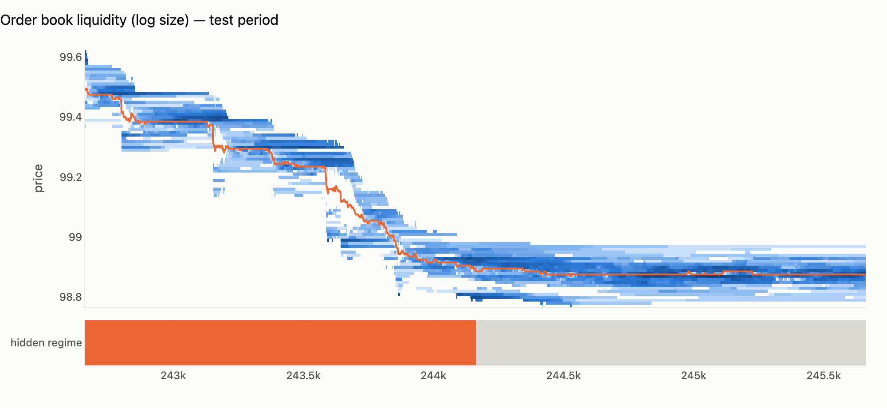
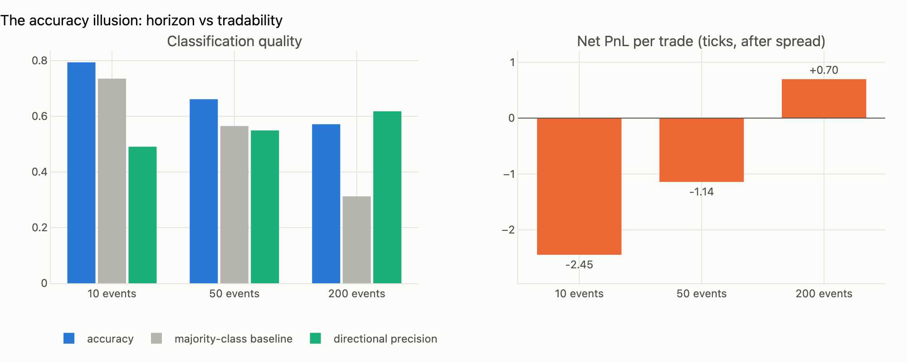
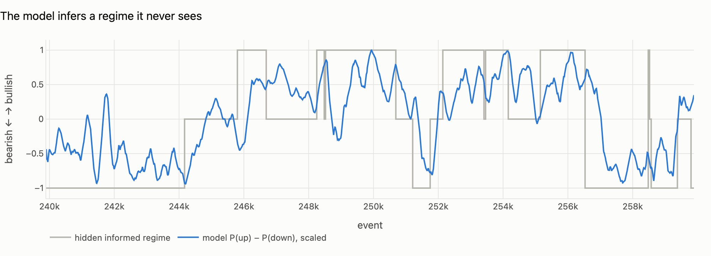
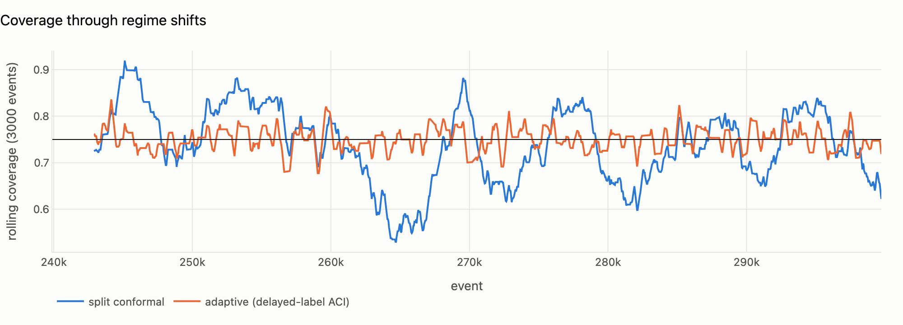
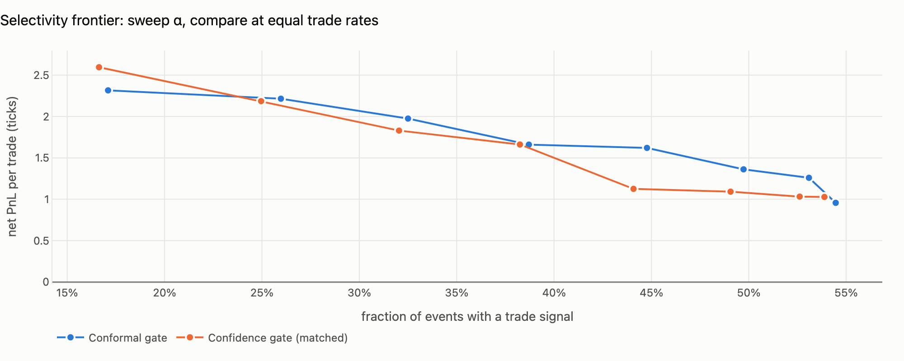
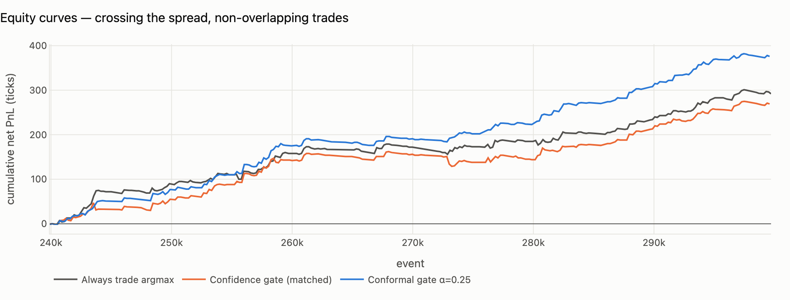

# QueueSight

**Conformal-gated limit order book forecasting, with execution-aware evaluation.**

Most LOB deep-learning projects report one number, classification accuracy on
FI-2010-style labels, and stop. That number is close to meaningless for a
trading desk. QueueSight asks the question a desk actually asks:

> *When the model says "up", how sure is it, and does that conviction survive
> crossing the spread, paying fees, and arriving late?*

It answers with three pieces:

1. **A queue-reactive order book simulator with a hidden informed trader.** A
   latent Markov regime tilts aggressive flow, passive placement and
   cancellations, much as an informed participant would. Any edge a model finds
   has to come from *inferring* that regime out of order flow, and because the
   simulator knows the ground truth, we can check whether the model did.
2. **Three forecasters behind one interface:** logistic regression on
   multi-level order flow imbalance (OFI), gradient-boosted trees on 24 microstructure
   features, and a DeepLOB-style conv+GRU on raw book snapshots.
3. **Conformal trade gating.** Any forecaster becomes a prediction-set
   generator with a finite-sample coverage guarantee. We trade **only when the
   set is exactly `{up}` or `{down}`** and abstain otherwise. α stops being an
   arbitrary confidence cutoff and becomes a *risk budget with statistical
   meaning*. Because order flow is non-stationary, we also run **Adaptive
   Conformal Inference with delayed labels**: a horizon-*h* forecast's outcome
   is only known *h* events later, and the online update respects that.

Everything is judged by an **execution-aware backtest**. You buy at the ask, sell
at the bid, fill *L* events after the signal, and never hold overlapping positions.



---

## Findings (300k events, seed 7; reproducible with `python -m queuesight.report`)

### 1. Accuracy is not edge

| horizon | accuracy | majority baseline | directional precision | net PnL / trade (ticks) |
|---:|---:|---:|---:|---:|
| 10 events  | **79.4%** | 73.5% | 49.1% | **−2.45** |
| 50 events  | 66.1% | 56.5% | 54.9% | −1.14 |
| 200 events | 57.2% | 31.2% | **61.8%** | **+0.70** |

The *most accurate* model is the *worst* strategy. At short horizons the mid
rarely moves, so the model wins accuracy by predicting "flat". When it does
call a direction it is no better than a coin flip, and every trade pays the
spread. Edge only shows up where expected moves exceed transaction costs.



### 2. The model recovers a regime it never observes

P(up) − P(down) correlates **≈0.5** with the hidden informed-trader state.
The classifier has effectively learned to filter a latent variable out of order
flow imbalance, microprice and cancellation asymmetry.



### 3. Coverage holds, and adaptive conformal holds it *through regime shifts*

Target coverage 1 − α = 0.75 on an unseen test window:

| method | coverage | avg set size | singleton rate |
|---|---:|---:|---:|
| Split conformal | 0.733 | 1.40 | 61% |
| Mondrian (class-conditional) | 0.733 | 1.40 | 60% |
| **Adaptive (ACI, delayed labels)** | **0.749** | 1.75 | 41% |

Split conformal undershoots because the test window's regime mix differs from
the calibration window (exchangeability is violated, as it always is in
markets). ACI widens its sets when it starts missing and recovers the target.



### 4. Trading the sets (h = 200, latency 1 event, no fees; model = logistic, picked on calibration log-loss)

| strategy | trades | hit rate | net PnL / trade (ticks) |
|---|---:|---:|---:|
| Always trade argmax | 271 | 36.9% | +1.08 |
| Confidence gate (τ matched to same trade rate) | 239 | 38.1% | +1.13 |
| Conformal gate (α = 0.25) | 232 | 43.1% | +1.62 |
| Adaptive conformal gate | 172 | 43.6% | +1.67 |

Sweeping α traces a selectivity frontier: lower α, fewer trades, more edge per
trade (≈ +2.3 ticks at α = 0.05). On *this* path the conformal gate looks
clearly better than the confidence gate. **Section 5 shows that this does not
generalise**, which is exactly why the section exists.




### 5. Robustness across 8 independent market paths

`python -m queuesight.robustness --seeds 8` (gradient boosting, h = 200, α = 0.25):

| metric | mean ± sd over 8 seeds | min / max |
|---|---:|---:|
| accuracy, h = 10 | 79.4% ± 1.1 | 78.0 / 81.1 |
| net PnL / trade, argmax, h = 10 | −2.52 ± 0.19 | −2.90 / −2.32 |
| accuracy, h = 200 | 58.9% ± 1.8 | 56.7 / 61.9 |
| net PnL / trade, argmax, h = 200 | +0.64 ± 0.21 | +0.30 / +0.91 |
| net PnL / trade, confidence gate (matched rate) | +0.85 ± 0.19 | +0.56 / +1.13 |
| net PnL / trade, conformal gate | +0.79 ± 0.25 | +0.33 / +1.05 |
| net PnL / trade, adaptive conformal gate | **+0.96 ± 0.25** | +0.70 / +1.37 |
| \|coverage − 0.75\|, split conformal | 0.014 ± 0.015 | 0.000 / 0.042 |
| \|coverage − 0.75\|, adaptive conformal | **0.001 ± 0.000** | 0.000 / 0.001 |

**The honest read:**

- **Robust:** the accuracy illusion (on every seed, the most accurate horizon
  loses about 2.5 ticks per trade). Also robust: gating beats always trading,
  and ACI's coverage guarantee survives regime shift (±0.001 of target on
  every path, versus misses of up to 4 points for split conformal). The
  adaptive gate beat argmax on 7 of 8 seeds.
- **Not robust:** at a *matched trade rate*, the plain conformal gate does
  **not** beat a tuned confidence threshold (−0.06 ± 0.12 ticks; better on
  only 2 of 8 seeds). Under LAC scores, both gates rank trades by similar
  information, and seed 7's gap was path luck.
- **So the case for conformal is not "more PnL".** It is that α is a risk
  budget with a *guarantee*. You choose it before seeing test data, it
  means the same thing across models (logistic, trees, a neural net), and with
  ACI it keeps meaning that when the market changes under you. A raw
  confidence threshold has to be re-tuned per model and per regime, with no
  statement about what it controls.

---

## Quick start

```bash
pip install -r requirements.txt

streamlit run app.py                 # interactive dashboard
python -m queuesight.report          # full run -> results/report.html (~1-2 min; --deep adds PyTorch)
python -m queuesight.robustness      # multi-seed study -> results/robustness_*.csv
pytest                               # 13 tests
```

The dashboard caches the simulation and training. The α, latency and fee
sliders re-run only the conformal and backtest layers, so they update instantly.

### Real data

`queuesight.book.load_lobster(message_csv, orderbook_csv)` maps
[LOBSTER](https://lobsterdata.com) files into the same `LOBData` container the
simulator emits, so the full pipeline runs unchanged on Nasdaq ITCH data:

```python
from queuesight.book import load_lobster
from queuesight.pipeline import run_experiment, ExperimentConfig
res = run_experiment(ExperimentConfig(), data=load_lobster("AAPL_message_10.csv", "AAPL_orderbook_10.csv"))
```

## Layout

```
queuesight/
  simulator.py   queue-reactive LOB + hidden informed regime
  book.py        LOBData container, LOBSTER loader
  features.py    multi-level OFI, microprice, imbalance, trade/cancel flow; smoothed labels
  models.py      logistic / gradient boosting / DeepLOB-lite, shared fit/predict_proba(idx)
  conformal.py   split, Mondrian, delayed-label ACI; set -> trade gating
  backtest.py    spread-crossing, latency, fees, non-overlapping positions
  pipeline.py    chronological split with embargo, experiment + analyses
  viz.py         Plotly figures shared by app and report
  report.py      CLI -> standalone HTML report
  robustness.py  multi-seed study
app.py           Streamlit dashboard
tests/           no-lookahead, book integrity, coverage guarantees, backtest accounting
```

## Methodological guardrails

- **No look-ahead.** A test recomputes features on a truncated history and
  checks that they are identical at the cut point.
- **Chronological 60/20/20 split with an embargo** of max-horizon events
  between train, calibration and test, so labels never straddle a boundary.
- **Model selection on calibration log-loss**, never on test.
- **Fair baselines.** The confidence-threshold gate's τ is chosen on the
  calibration window to trade at the *same rate* as the conformal gate.
- **Delayed feedback** in ACI: no error is used before its label could exist.

## Limitations

- The headline numbers come from a simulator. It is designed to be realistic
  (one-tick spread 86% of the time, depth-reactive cancellation, informed flow
  hidden in noise), but it is still a model of a market. Run it on LOBSTER
  before believing any PnL.
- Execution is aggressive-only (market in, market out). Passive entry with
  queue-position modelling would change the economics substantially.
- Each strategy makes a few hundred non-overlapping trades per path. That's
  why the robustness study exists.

## References

- Cont, Kukanov & Stoikov (2014). *The price impact of order book events.*
- Xu, Gould & Howison (2018). *Multi-level order-flow imbalance in a limit order book.*
- Stoikov (2018). *The micro-price.*
- Huang, Lehalle & Rosenbaum (2015). *Simulating and analyzing order book data: the queue-reactive model.*
- Zhang, Zohren & Roberts (2019). *DeepLOB.*
- Ntakaris et al. (2018). *Benchmark dataset for mid-price forecasting of LOB data* (FI-2010).
- Angelopoulos & Bates (2021). *A gentle introduction to conformal prediction.*
- Gibbs & Candès (2021). *Adaptive conformal inference under distribution shift.*
